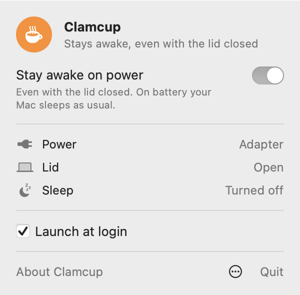
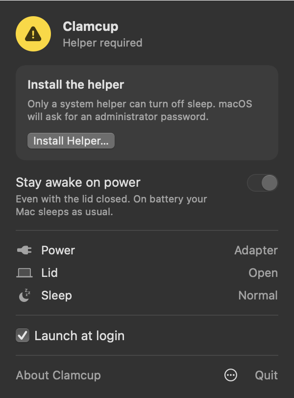

<p align="center"></p>

<h1 align="center">Clamcup</h1>

<p align="center">Keeps your Mac awake on power, even with the lid closed. On battery it sleeps as usual.</p>

<p align="center"><a href="README.ru.md">По-русски</a></p>

<p align="center">
  
  
</p>

## What it does

A MacBook goes to sleep when you close the lid, unless it runs in clamshell mode with an external display. Clamcup turns this off while the Mac is on power:

- Plugged in, switch on: the Mac doesn't sleep, lid open or closed.
- Unplugged: normal sleep comes back right away.
- Unplugged with the lid already closed (say, straight into a bag): the Mac goes to sleep within a few seconds.
- Helper stopped or uninstalled: normal sleep comes back.

The menu bar icon shows the state: a steaming cup while sleep is off, an empty cup otherwise.

## Install

Requires macOS 14 Sonoma or later, Apple silicon or Intel.

1. Download `Clamcup-<version>.dmg` from [Releases](https://github.com/snaiperlfc/Clamcup/releases).
2. Open it and drag Clamcup to Applications.
3. Open Clamcup. The release isn't signed with an Apple Developer ID, so macOS blocks the first launch:
   - macOS 15 and later: open System Settings → Privacy & Security, scroll down and click **Open Anyway**.
   - macOS 14: right-click the app in Finder and choose **Open**.

   Or remove the quarantine flag in Terminal: `xattr -dr com.apple.quarantine /Applications/Clamcup.app`
4. Click the cup in the menu bar, then **Install Helper…** and enter your administrator password.

Check the SHA-256 of the DMG against the `.sha256` file next to it in the release if you want to be sure it's the same file.

## How it works

Only root can turn off lid sleep, so Clamcup has two parts:

- **The app** in the menu bar. It has no root rights. It writes the mode (`auto` or `off`) to a file and shows the current state.
- **The helper**, a launchd daemon running as root. It watches the power source through IOKit and the mode file through kqueue, and switches `pmset disablesleep`. Every 60 seconds it re-checks, in case something else changed the setting.

The helper reads only the word `off` from the mode file and treats anything else as `auto`, so a broken file can't make it do anything unexpected.

Files the helper installs:

| Path | What |
|---|---|
| `/Library/PrivilegedHelperTools/io.github.snaiperlfc.Clamcup.helper` | helper binary |
| `/Library/LaunchDaemons/io.github.snaiperlfc.Clamcup.helper.plist` | launchd job |
| `/Library/Application Support/Clamcup/` | mode file, installed version, PID |
| `/var/log/clamcup.log` | log: each sleep switch and mode change |

## Be careful

With Clamcup on, a Mac on a charger keeps running with the lid closed. If you put it in a bag while it's still plugged in, it won't sleep. Unplug it or turn the switch off first.

## Uninstall

In the panel, click **⋯ → Uninstall Helper…**, then move the app to the Trash. Without the app:

```bash
sudo /Applications/Clamcup.app/Contents/Resources/uninstall-helper.sh
```

## Why not the Mac App Store

App Store apps run in a sandbox and can't get root rights. Turning off lid sleep needs root.

## Build from source

You need Xcode 16 or later.

```bash
swift test                    # policy tests
swift build && Tests/helper-live-test.sh   # runs the helper without root in dry-run mode
scripts/bundle.sh             # build/Clamcup.app, universal, ad-hoc signed
scripts/dmg.sh                # build/Clamcup-<version>.dmg
```

`scripts/make-icon.sh` redraws the icon from `scripts/make-icon.swift`.

To release: update `VERSION` and `CHANGELOG.md`, then push a `vX.Y.Z` tag. GitHub Actions runs the tests, builds the DMG and publishes the release.

## License

[MIT](LICENSE)
