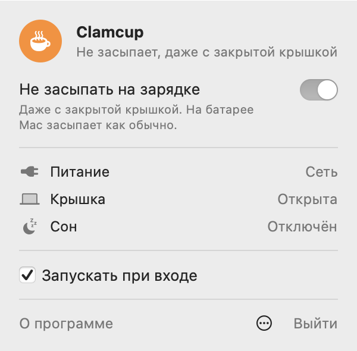
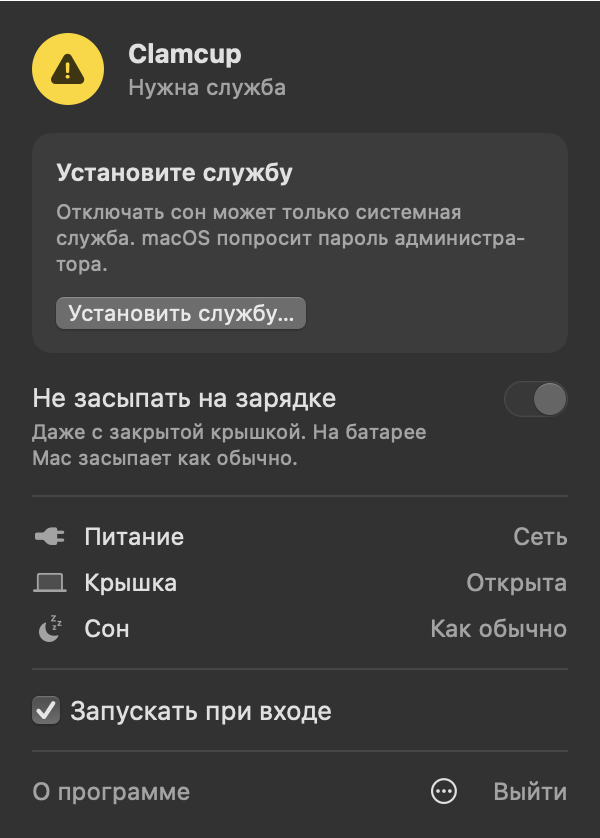

<p align="center"></p>

<h1 align="center">Clamcup</h1>

<p align="center">Не даёт Mac засыпать на зарядке, даже с закрытой крышкой. На батарее Mac засыпает как обычно.</p>

<p align="center"><a href="README.md">English</a></p>

<p align="center">
  
  
</p>

## Что делает

MacBook засыпает, когда закрываешь крышку, если только он не работает в режиме clamshell с внешним монитором. Clamcup отключает это, пока Mac на зарядке:

- На зарядке и с включённым переключателем Mac не засыпает ни с открытой, ни с закрытой крышкой.
- Сняли с зарядки — обычный сон возвращается сразу.
- Сняли с зарядки, когда крышка уже закрыта (например, сразу в рюкзак), — Mac засыпает через несколько секунд.
- Служба остановлена или удалена — обычный сон возвращается.

Значок в строке меню показывает состояние: кружка с паром, пока сон отключён, и пустая кружка в остальных случаях.

## Установка

Нужна macOS 14 Sonoma или новее, Apple silicon или Intel.

1. Скачайте `Clamcup-<версия>.dmg` со страницы [Releases](https://github.com/snaiperlfc/Clamcup/releases).
2. Откройте образ и перетащите Clamcup в «Программы».
3. Запустите Clamcup. Релиз не подписан сертификатом Apple Developer ID, поэтому первый запуск macOS заблокирует:
   - macOS 15 и новее: откройте «Системные настройки» → «Конфиденциальность и безопасность», прокрутите вниз и нажмите **«Всё равно открыть»**.
   - macOS 14: в Finder щёлкните по приложению правой кнопкой и выберите **«Открыть»**.

   Или снимите карантин в Терминале: `xattr -dr com.apple.quarantine /Applications/Clamcup.app`
4. Щёлкните по кружке в строке меню, нажмите **«Установить службу…»** и введите пароль администратора.

Чтобы убедиться, что скачали тот самый файл, сверьте SHA-256 образа с файлом `.sha256` рядом с ним в релизе.

## Как устроено

Отключить сон по закрытию крышки может только root, поэтому в Clamcup две части:

- **Приложение** в строке меню. Прав root у него нет. Оно пишет режим (`auto` или `off`) в файл и показывает текущее состояние.
- **Служба** — демон launchd, работает от root. Следит за источником питания через IOKit и за файлом режима через kqueue, переключает `pmset disablesleep`. Раз в 60 с перепроверяет состояние на случай, если настройку поменял кто-то другой.

Из файла режима служба берёт только слово `off`, всё остальное считает `auto`. Поэтому испорченный файл не заставит её сделать что-то неожиданное.

Что ставит служба:

| Путь | Что это |
|---|---|
| `/Library/PrivilegedHelperTools/io.github.snaiperlfc.Clamcup.helper` | бинарник службы |
| `/Library/LaunchDaemons/io.github.snaiperlfc.Clamcup.helper.plist` | задание launchd |
| `/Library/Application Support/Clamcup/` | файл режима, установленная версия, PID |
| `/var/log/clamcup.log` | журнал: каждое переключение сна и смена режима |

## Осторожно

Пока Clamcup включён, Mac на зарядке продолжает работать с закрытой крышкой. Если убрать его в рюкзак, не отключив от зарядки, он не уснёт. Сначала отключите зарядку или выключите переключатель.

## Удаление

В панели нажмите **⋯ → «Удалить службу…»**, потом перенесите приложение в Корзину. Без приложения:

```bash
sudo /Applications/Clamcup.app/Contents/Resources/uninstall-helper.sh
```

## Почему не в Mac App Store

Приложения из App Store работают в песочнице и не могут получить права root. А без root сон по закрытию крышки не отключить.

## Сборка из исходников

Нужен Xcode 16 или новее.

```bash
swift test                    # тесты логики службы
swift build && Tests/helper-live-test.sh   # живой прогон службы без root, вхолостую
scripts/bundle.sh             # build/Clamcup.app, универсальный, подпись ad-hoc
scripts/dmg.sh                # build/Clamcup-<версия>.dmg
```

`scripts/make-icon.sh` перерисовывает иконку из `scripts/make-icon.swift`.

Выпуск релиза: обновите `VERSION` и `CHANGELOG.md`, затем запушьте тег `vX.Y.Z`. GitHub Actions прогонит тесты, соберёт DMG и опубликует релиз.

## Лицензия

[MIT](LICENSE)
